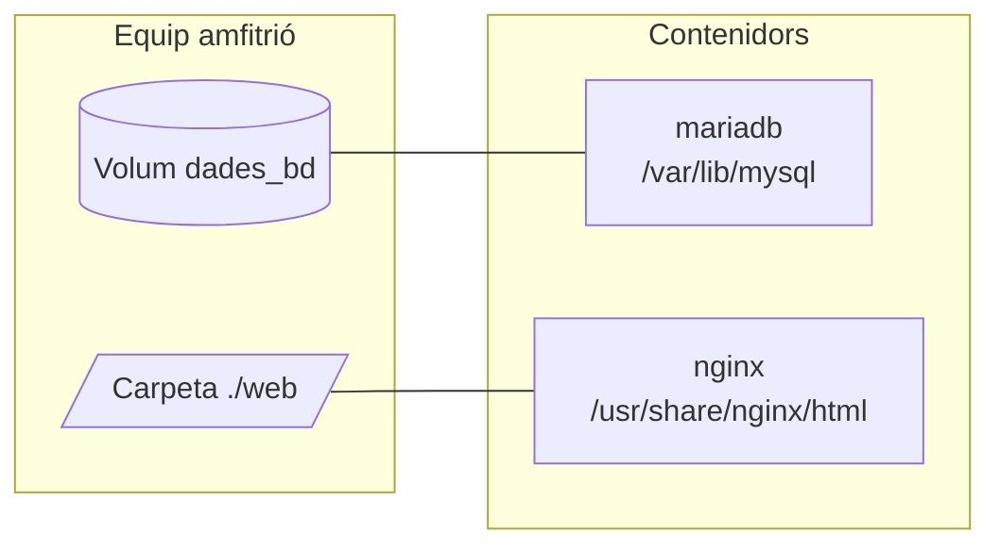

# 4. Emmagatzematge

## El problema: els contenidors són efímers

Prova açò:

```bash
docker run -d --name bd -e MARIADB_ROOT_PASSWORD=secret mariadb:11.4
# ... crees una base de dades, hi poses dades ...
docker rm -f bd
```

Si tornes a crear el contenidor, **les dades ja no hi són**. Tot el que s'escriu dins d'un contenidor es guarda en la seua capa d'escriptura, i eixa capa desapareix quan l'esborres.

La solució és guardar les dades **fora** del contenidor. Hi ha dues maneres:

| | Volum | Bind mount |
| - | ----- | ---------- |
| Què és | un espai que crea i gestiona Docker | una carpeta del teu equip que "connectes" amb el contenidor |
| On es guarda | `/var/lib/docker/volumes/...` (no cal tocar-ho) | on tu digues |
| Exemple | `-v dades_bd:/var/lib/mysql` | `-v ./web:/usr/share/nginx/html` |
| Ideal per a | **bases de dades** i dades de l'aplicació | **codi** i fitxers de configuració que vols editar |



## Volums

### Crear-los i gestionar-los

```bash
docker volume create dades_bd       # crear
docker volume ls                    # llistar
docker volume inspect dades_bd      # on està i quina informació té
docker volume rm dades_bd           # esborrar (no ha d'usar-lo cap contenidor)
docker volume prune                 # esborrar els que no usa ningú
```

### Usar-los

```bash
docker run -d --name bd \
    -e MARIADB_ROOT_PASSWORD=secret \
    -v dades_bd:/var/lib/mysql \
    mariadb:11.4
```

`-v NOM_VOLUM:CARPETA_DINS` → tot el que MariaDB guarde en `/var/lib/mysql` va realment al volum `dades_bd`.

Ara pots esborrar el contenidor i crear-ne un de nou amb el mateix volum: **les dades continuen allí**.

!!! tip "No cal crear el volum abans"
    Si el volum no existix, `docker run -v nom:...` el crea automàticament.

!!! question "Com sé quina carpeta de dins he de guardar?"
    Ho diu la documentació de la imatge en Docker Hub. Les més habituals:

    | Imatge | Carpeta de dades |
    | ------ | ---------------- |
    | `mariadb`, `mysql` | `/var/lib/mysql` |
    | `postgres` | `/var/lib/postgresql/data` |
    | `nginx` | `/usr/share/nginx/html` (la web) |
    | `httpd` (Apache) | `/usr/local/apache2/htdocs` |
    | `php:*-apache`, `wordpress` | `/var/www/html` |
    | `nextcloud` | `/var/www/html` |

## Bind mounts: connectar una carpeta teua

```bash
mkdir web
echo "<h1>Hola des de Docker</h1>" > web/index.html

docker run -d --name web1 -p 8080:80 \
    -v "$(pwd)/web":/usr/share/nginx/html \
    nginx:1.27
```

Ara `http://localhost:8080` mostra el teu `index.html`. I si edites el fitxer en el teu equip, el canvi es veu **immediatament** en el contenidor, sense reiniciar res. Per això és ideal mentre desenvolupes.

!!! warning "La ruta ha de ser absoluta (o començar per `./` en Compose)"
    En `docker run`, si poses `-v web:/...` (sense `/` ni `./`), Docker entén que `web` és el **nom d'un volum**, no una carpeta. Usa `"$(pwd)/web"` o la ruta completa. En PowerShell: `"${PWD}/web"`.

### Només lectura

Si el contenidor només ha de **llegir** els fitxers (per exemple, la configuració), afig `:ro` (*read only*):

```bash
-v "$(pwd)/nginx.conf":/etc/nginx/conf.d/default.conf:ro
```

## Còpia de seguretat d'un volum

Un truc habitual: un contenidor temporal que munta el volum i una carpeta del teu equip, i comprimix l'un en l'altra:

```bash
docker run --rm \
    -v dades_bd:/origen:ro \
    -v "$(pwd)":/backup \
    alpine tar czf /backup/dades_bd.tar.gz -C /origen .
```

Per a una base de dades és millor fer un *dump*:

```bash
docker exec bd mariadb-dump -u root -psecret --all-databases > backup.sql
```

## Copiar fitxers puntualment: `docker cp`

```bash
docker cp fitxer.txt web1:/tmp/          # del teu equip al contenidor
docker cp web1:/etc/nginx/nginx.conf .   # del contenidor al teu equip
```

## Errors típics

| Error | Per què | Solució |
| ----- | ------- | ------- |
| He perdut les dades de la base de dades | No tenia volum | Sempre `-v nom:/var/lib/mysql` |
| El bind mount ix buit | La ruta és relativa i Docker l'ha pres com a nom de volum | Usa `"$(pwd)/carpeta"` |
| `Permission denied` en un bind mount | Els permisos de la carpeta no deixen escriure l'usuari del contenidor | Revisa propietari i permisos (`chown`, `chmod`) |
| `volume is in use` en esborrar-lo | Un contenidor (encara que estiga parat) l'usa | Esborra el contenidor abans |
| MariaDB no canvia la contrasenya encara que canvie la variable | La base de dades ja s'havia creat en el volum | Les variables només s'apliquen la **primera** vegada; esborra el volum si vols començar de zero |

!!! success "Per a l'examen"
    - Els contenidors són **efímers**: si l'esborres, perds el que hi havia dins
    - **Volum**: `-v nom_volum:/carpeta/dins` → per a dades (bases de dades)
    - **Bind mount**: `-v "$(pwd)/carpeta":/carpeta/dins` → per a codi i configuració
    - `:ro` → només lectura
    - `docker volume ls / create / rm / prune`
    - `docker cp origen destí`
