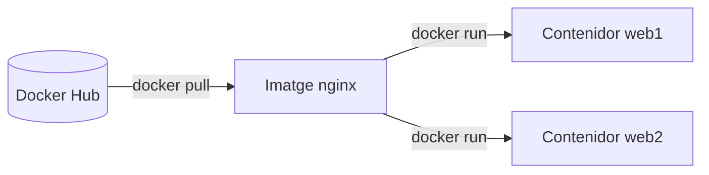

# Docker

## Què és Docker?

**Docker** permet executar aplicacions dins de **contenidors**: paquets que porten l'aplicació i tot el que necessita (llibreries, configuració...) per a funcionar igual en qualsevol ordinador.

!!! example "El problema que resol"
    "*En el meu ordinador funcionava!*". Una aplicació web necessita una versió concreta de PHP, unes extensions, una base de dades configurada... Instal·lar-ho tot a mà en cada màquina és lent i sempre falla alguna cosa. Amb Docker, defines l'entorn una vegada en un fitxer, i qualsevol persona l'arranca amb una ordre.

## Contenidor o màquina virtual?

| | Màquina virtual | Contenidor |
| - | --------------- | ---------- |
| Què porta | un sistema operatiu sencer | només l'aplicació i les seues llibreries |
| Mida | gigabytes | megabytes |
| Arrancar | minuts | segons |
| Kernel | el seu propi | comparteix el del sistema amfitrió |
| Ús típic | executar un altre sistema operatiu | executar aplicacions i serveis |

Un contenidor **no** és una màquina virtual: és un procés aïllat que usa el kernel de l'equip on s'executa.

## Les tres idees bàsiques

| Concepte | Què és | Comparació |
| -------- | ------ | ---------- |
| **Imatge** | una plantilla de només lectura amb l'aplicació preparada | la recepta, o un CD d'instal·lació |
| **Contenidor** | una imatge en execució | el plat cuinat, o el programa instal·lat i funcionant |
| **Registre** | el lloc d'on es descarreguen les imatges (normalment **Docker Hub**) | la botiga d'aplicacions |

D'una mateixa imatge (per exemple `nginx`) pots crear tants contenidors com vulgues.

## Ordre recomanat

| Tema | Què aprens |
| ---- | ---------- |
| [1. Instal·lació](01-installacio.md) | instal·lar Docker en Linux i Windows |
| [2. Contenidors](02-contenidors.md) | crear, arrancar, parar, entrar i esborrar contenidors |
| [3. Imatges](03-imatges.md) | descarregar, llistar i esborrar imatges; etiquetes |
| [4. Emmagatzematge](04-emmagatzematge.md) | volums i bind mounts per a no perdre dades |
| [5. Xarxes](05-xarxes.md) | connectar contenidors entre ells |
| [6. Docker Compose](06-compose.md) | definir diversos contenidors en un fitxer `compose.yaml` |
| [7. Crear imatges: Dockerfile](07-dockerfile.md) | fer les teues pròpies imatges |

Després: [exercicis resolts](exercicis.md), entre ells un **entorn PHP + MariaDB reproduïble** com els que demanen a IAW.

!!! tip "Durant un examen"
    Cada tema acaba amb el requadre verd **«Per a l'examen»**. La [xuleta de Docker](../xuletes/docker.md) ho resumix tot en una pàgina.
