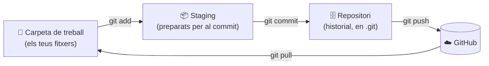

# 1. Conceptes i configuració

## Les paraules clau

| Paraula | Què és |
| ------- | ------ |
| **Repositori** (repo) | una carpeta controlada per Git. Té una carpeta oculta `.git` on es guarda tot l'historial |
| **Commit** | una "foto" del projecte en un moment, amb un missatge que explica què has canviat |
| **Branca** (branch) | una línia de treball. La principal es diu `main` |
| **Remot** (remote) | una còpia del repositori en un altre lloc (GitHub). Normalment es diu `origin` |
| **Clonar** | descarregar un repositori remot al teu ordinador |
| **Push** | pujar els teus commits al remot |
| **Pull** | baixar els commits del remot al teu ordinador |

!!! danger "La carpeta `.git` és el repositori"
    Tot l'historial està dins de la carpeta oculta `.git` (la veus amb `ls -a`). Si l'esborres, o si substituïxes la carpeta del projecte per una altra que no la té, **la carpeta deixa de ser un repositori**: perds l'historial i la connexió amb GitHub.

## Les tres zones

Este és el concepte més important per a entendre Git. Un fitxer pot estar en tres llocs:



| Zona | Què hi ha | Com s'hi arriba |
| ---- | --------- | --------------- |
| **Carpeta de treball** | els fitxers tal com els tens ara, amb els teus canvis | editant |
| **Staging** (àrea de preparació) | els canvis que has triat per al pròxim commit | `git add` |
| **Repositori local** | tots els commits fets | `git commit` |
| **Remot** (GitHub) | la còpia en Internet | `git push` |

!!! example "Una analogia"
    Estàs fent una mudança. La **carpeta de treball** és la teua casa amb totes les coses. El **staging** és la caixa on vas posant el que vols enviar (`git add`). Quan la caixa està llesta, la tanques i li poses una etiqueta: això és el **commit**. El **push** és enviar les caixes al camió (GitHub).

Per què el pas del staging? Perquè així pots fer commits xicotets i ordenats: si has canviat 5 fitxers però només 2 tenen a veure amb una cosa, fas `add` d'eixos 2, commit, i després la resta.

## Instal·lar Git

```bash
sudo apt install git        # Debian / Ubuntu
git --version
```

En Windows: descarrega **Git for Windows** de [git-scm.com](https://git-scm.com). Porta el **Git Bash**, un terminal on funcionen les mateixes ordres que en Linux.

## Configurar-lo (una sola vegada)

Git posa el teu nom i correu en cada commit:

```bash
git config --global user.name "El teu nom"
git config --global user.email "el-teu-correu@exemple.com"
git config --global init.defaultBranch main     # que les branques noves es diguen main
git config --global pull.rebase false           # com fer els pull (vegeu el tema 3)
git config --global core.editor nano            # l'editor per als missatges (per defecte és vim)
```

```bash
git config --list           # veure tota la configuració
```

!!! tip "El correu"
    Usa el mateix correu que en el teu compte de GitHub: així els commits apareixen associats al teu perfil.

## Connectar-se a GitHub: HTTPS o SSH

Per a pujar coses a GitHub has de demostrar qui eres. Hi ha dues formes:

| | HTTPS | SSH ⭐ |
| - | ----- | ------ |
| URL | `https://github.com/usuari/repo.git` | `git@github.com:usuari/repo.git` |
| Com t'identifiques | usuari + **token** (no la contrasenya!) | una clau SSH, configurada una vegada |
| Cada vegada que fas push | et pot demanar el token | no et demana res |

!!! danger "La contrasenya de GitHub no funciona en el terminal"
    Des de 2021, GitHub **no accepta la contrasenya** del compte en `git push`. Si uses HTTPS, has de crear un *Personal Access Token* (GitHub → Settings → Developer settings → Personal access tokens) i posar-lo on demana la contrasenya. Per això és més còmode **SSH**.

### Configurar SSH (recomanat)

```bash
# 1. Comprovar si ja tens una clau
ls ~/.ssh/id_ed25519.pub

# 2. Si no la tens, crear-la (prem Intro per a acceptar la ruta)
ssh-keygen -t ed25519 -C "el-teu-correu@exemple.com"

# 3. Mostrar la clau PÚBLICA i copiar-la sencera
cat ~/.ssh/id_ed25519.pub
```

4. En GitHub: **Settings → SSH and GPG keys → New SSH key**, posa-li un nom i enganxa la clau.
5. Comprova la connexió:

```bash
ssh -T git@github.com
```

```console
Hi usuari! You've successfully authenticated, but GitHub does not provide shell access.
```

Si veus el teu usuari, ja està. La primera vegada et preguntarà si confies en el servidor: respon `yes`.

!!! warning "Pública i privada"
    `ssh-keygen` crea dos fitxers: `id_ed25519` (**privada**, no la dones a ningú) i `id_ed25519.pub` (**pública**, la que poses en GitHub).

## Errors típics

| Error | Per què | Solució |
| ----- | ------- | ------- |
| `Please tell me who you are` en fer commit | No has configurat nom i correu | `git config --global user.name/user.email` |
| `fatal: not a git repository` | No estàs dins d'un repositori (o la carpeta no té `.git`) | `cd` a la carpeta correcta, o `git init` / `git clone` |
| Et demana usuari i contrasenya en cada push | El remot és HTTPS | Canvia a SSH: `git remote set-url origin git@github.com:usuari/repo.git` |
| `Permission denied (publickey)` | La clau SSH no està en GitHub, o no és la correcta | Revisa els passos de SSH; prova `ssh -T git@github.com` |
| S'obri un editor estrany (vim) en fer commit | No has posat `-m` | Escriu el missatge, `Esc`, `:wq`, Intro. O configura `core.editor nano` |

!!! success "Per a l'examen"
    - **Repositori** = carpeta amb `.git` · **Commit** = foto del projecte · **Remot** = còpia en GitHub (`origin`)
    - Tres zones: **carpeta de treball** → `git add` → **staging** → `git commit` → **repositori** → `git push` → **GitHub**
    - Configurar: `git config --global user.name "..."` i `user.email "..."`
    - GitHub no accepta la contrasenya: **token** (HTTPS) o **clau SSH**
    - SSH: `ssh-keygen -t ed25519` → copiar `.pub` a GitHub → `ssh -T git@github.com`
