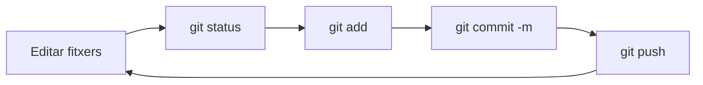

# 2. El treball diari

## Començar un repositori

Hi ha dues maneres:

| Situació | Ordre |
| -------- | ----- |
| El projecte **ja està en GitHub** (o en el professor) | `git clone URL` → [tema 3](03-github.md) |
| Tens una carpeta **nova** en el teu equip | `git init` |

```bash
mkdir el-meu-projecte && cd el-meu-projecte
git init
```

```console
Initialized empty Git repository in /home/ana/el-meu-projecte/.git/
```

## El cicle de cada dia



```bash
git status                          # 1. què ha canviat?
git add fitxer.sh                   # 2. preparar els canvis
git commit -m "Afig exercici 3"     # 3. guardar-los en l'historial
git push                            # 4. pujar-los a GitHub
```

## `git status`: què està passant?

És l'ordre que més usaràs. Executa-la **sempre** abans de fer res.

```console
$ git status
On branch main
Changes not staged for commit:
        modified:   README.md

Untracked files:
        nou.txt
```

| Diu... | Significa |
| ------ | --------- |
| `Untracked files` | fitxers **nous** que Git encara no controla |
| `Changes not staged for commit` | fitxers **modificats** que encara no has afegit amb `add` |
| `Changes to be committed` | fitxers **preparats** (en staging): entraran en el pròxim commit |
| `nothing to commit, working tree clean` | no hi ha cap canvi pendent ✅ |

Versió curta: `git status -s`

```console
 M README.md      ← modificat (M a la dreta: encara no està en staging)
M  script.sh      ← modificat i en staging (M a l'esquerra)
A  nou.sh         ← nou i en staging
?? prova.txt      ← nou, sense controlar
```

## `git add`: preparar els canvis

```bash
git add fitxer.txt          # un fitxer
git add carpeta/            # una carpeta sencera
git add .                   # TOT el que ha canviat en la carpeta actual i subcarpetes
git add *.sh                # tots els .sh
```

!!! warning "Revisa abans de fer `git add .`"
    `git add .` ho afig **tot**, també fitxers que no vols (contrasenyes, fitxers temporals...). Fes `git status` abans i usa un `.gitignore` (vegeu baix).

## `git commit`: guardar en l'historial

```bash
git commit -m "Afig l'exercici de bucles"
```

Si poses `-m`, el missatge va directament. Sense `-m`, s'obri un editor perquè l'escrigues.

```bash
git commit -am "Corregix l'exercici 2"     # add + commit dels fitxers JA controlats (no dels nous)
```

### Com escriure un bon missatge

| ❌ Malament | ✅ Bé |
| ----------- | ----- |
| `canvis` | `Afig validació d'arguments a backup.sh` |
| `asdf` | `Corregix el càlcul del percentatge` |
| `fet` | `Completa els exercicis 1-5 de la UT2` |
| `arreglat tot` | `Lleva el fitxer .env del repositori` |

- Diu **què** fa el commit, en poques paraules.
- Comença amb un verb: *Afig, Corregix, Elimina, Actualitza...*
- Un commit = **un canvi amb sentit**. Millor molts commits xicotets que un gegant.

## `git log`: veure l'historial

```bash
git log                         # complet
git log --oneline               # una línia per commit ⭐
git log --oneline --graph --all # amb dibuix de les branques
git log -3                      # només els 3 últims
git log fitxer.sh               # només els que han tocat eixe fitxer
```

```console
$ git log --oneline
6dc31db (HEAD -> main, origin/main) Afig l'exercici de bucles
875bfc6 Corregix el càlcul del percentatge
155969d Primer commit
```

- El codi de l'esquerra (`6dc31db`) és l'**identificador** del commit (hash).
- `HEAD` és "on estàs ara".
- `origin/main` és on està la branca `main` en GitHub (l'última vegada que ho vas mirar).

## `git diff`: què he canviat exactament?

```bash
git diff                # canvis que encara NO estan en staging
git diff --staged       # canvis que SÍ estan en staging (el que entrarà en el commit)
git diff fitxer.sh      # només d'un fitxer
```

```diff
-echo "Hola"
+echo "Hola, $USER"
```

Les línies amb `-` (en roig) s'han llevat; les de `+` (en verd), afegit.

## `.gitignore`: fitxers que Git ha d'ignorar

Un fitxer de text anomenat `.gitignore`, en l'arrel del repositori, amb els noms o patrons dels fitxers que **no** s'han de pujar mai:

```text title=".gitignore"
# Contrasenyes i configuració local
.env

# Entorns virtuals i memòria cau de Python
.venv/
__pycache__/

# Fitxers temporals i del sistema
*.log
*.tmp
.DS_Store
Thumbs.db

# Carpetes generades
node_modules/
site/
```

!!! danger "Mai pugues contrasenyes"
    Si pugues un fitxer amb contrasenyes a GitHub (encara que l'esborres després), queda en l'historial. Posa'l en el `.gitignore` **abans** del primer `git add`. Si ja ho has fet, mira els [casos pràctics](casos.md#he-pujat-un-fitxer-amb-contrasenyes).

!!! note "`.gitignore` no afecta fitxers que ja controla Git"
    Si un fitxer ja estava en un commit, afegir-lo al `.gitignore` no fa res. Primer cal llevar-lo: `git rm --cached fitxer`.

## Moure i esborrar fitxers

```bash
git mv vell.sh nou.sh        # reanomenar (Git ho registra com a canvi de nom)
git rm fitxer.txt            # esborrar del repositori i de la carpeta
git rm --cached fitxer.txt   # deixar de controlar-lo, però NO l'esborra de la carpeta
```

## Errors típics

| Error | Per què | Solució |
| ----- | ------- | ------- |
| `nothing added to commit but untracked files present` | Has fet commit sense `add` | `git add fitxer` i després commit |
| `nothing to commit, working tree clean` | No hi ha canvis, o ja estan en un commit | Normal: no cal fer res |
| `git commit -am` no inclou un fitxer nou | `-a` només afig els fitxers que Git ja coneixia | `git add fitxer_nou` abans |
| El `.gitignore` no ignora un fitxer | Ja estava controlat | `git rm --cached fitxer` i commit |
| He fet `git add` d'un fitxer que no volia | Encara no hi ha commit | `git restore --staged fitxer` |

!!! success "Per a l'examen"
    ```bash
    git init                         # crear repositori
    git status                       # ⭐ sempre abans de res
    git add fitxer / git add .       # preparar
    git commit -m "Missatge clar"    # guardar
    git log --oneline --graph        # historial
    git diff / git diff --staged     # què he canviat
    git rm --cached fitxer           # deixar de controlar-lo
    ```
    - `.gitignore` → el que no s'ha de pujar (`.env`, `.venv/`, `*.log`)
    - Missatges amb verb i clars: *«Afig validació a backup.sh»*
