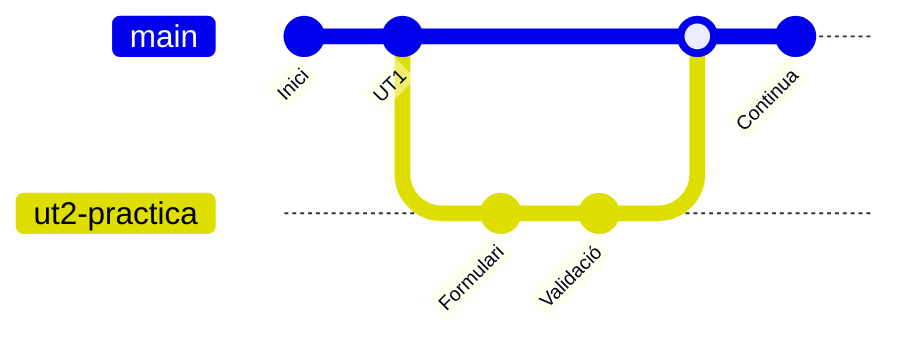

# 4. Branques

## Què és una branca

Una **branca** és una línia de treball independent. Permet fer canvis **sense tocar** la versió principal (`main`) fins que estiguen acabats i revisats.



!!! example "Per què"
    Estàs fent la pràctica 2 en una branca. A meitat, el professor et diu que corregisques una cosa de la pràctica 1. Tornes a `main`, ho corregixes, i després continues amb la pràctica 2 on la vas deixar. Les dues coses no es barregen.

## Gestionar branques

```bash
git branch                     # llistar les locals (* = on estàs)
git branch -a                  # també les de GitHub
git switch -c ut2-practica-1   # CREAR una branca nova i canviar-s'hi
git switch main                # canviar a una branca que ja existix
git branch -d ut2-practica-1   # esborrar una branca (ja fusionada)
git branch -D ut2-practica-1   # esborrar-la encara que no estiga fusionada (compte!)
```

!!! note "`switch` i `checkout`"
    En molts tutorials veuràs `git checkout -b nom` (crear) i `git checkout nom` (canviar). Fan el mateix que `git switch -c nom` i `git switch nom`. `switch` és la forma moderna.

!!! warning "Abans de canviar de branca, fes commit"
    Si tens canvis sense guardar, Git pot no deixar-te canviar de branca (o se'ls endurà a l'altra). Fes commit o guarda'ls amb `git stash` ([tema 6](06-desfer.md#stash-guardar-canvis-temporalment)).

### Pujar una branca a GitHub

```bash
git push -u origin ut2-practica-1     # la primera vegada
git push                              # les següents
```

### Noms de branques

Sense espais ni accents. Que diguen què es fa:

| ✅ Bé | ❌ Malament |
| ----- | ----------- |
| `ut1-ejercicios` | `branca nova` |
| `ut2-practica-1-presupuesto` | `prova` |
| `corregix-validacio-login` | `asdf` |

## Fusionar: `git merge`

Quan la feina d'una branca està acabada, s'ajunta amb `main`:

```bash
git switch main                 # 1. anar a la branca que REP els canvis
git pull                        # 2. assegurar-se que està actualitzada
git merge ut2-practica-1        # 3. portar els canvis de la branca
git push                        # 4. pujar-ho
git branch -d ut2-practica-1    # 5. esborrar la branca, que ja no cal
```

!!! tip "En les entregues no es fa així"
    Si el professor us demana **Pull Requests**, la fusió no es fa amb `git merge` en el teu equip, sinó des de la web de GitHub després que ell la revise. Mira el [tema 5](05-pull-requests.md).

## Conflictes

Un **conflicte** passa quan dues branques (o tu i un company) han canviat **la mateixa línia del mateix fitxer**. Git no sap quina versió triar i et demana que decidisques tu.

```console
$ git merge altra-branca       (o git pull)
CONFLICT (content): Merge conflict in README.md
Automatic merge failed; fix conflicts and then commit the result.
```

No passa res: no s'ha perdut res. Obri el fitxer i veuràs una cosa així:

```text
<<<<<<< HEAD
Hola de Ana
=======
Hola de Pep
>>>>>>> altra-branca
pep
```

| Tros | Significa |
| ---- | --------- |
| entre `<<<<<<< HEAD` i `=======` | la **teua** versió |
| entre `=======` i `>>>>>>>` | la versió que **arriba** |

### Resoldre'l en 4 passos

1. **Edita el fitxer**: deixa el text com ha de quedar (una versió, l'altra o una barreja) i **esborra les tres línies de marques** (`<<<<<<<`, `=======`, `>>>>>>>`).

    ```text
    Hola a tots
    pep
    ```

2. **Marca'l com a resolt**:

    ```bash
    git add README.md
    ```

3. **Fes el commit** de la fusió:

    ```bash
    git commit -m "Resol el conflicte en README.md"
    ```

4. **Puja-ho**: `git push`.

!!! tip "Si et fas un embolic"
    `git merge --abort` cancel·la la fusió i deixa tot com estava abans de començar.

!!! tip "VS Code ajuda"
    VS Code detecta els conflictes i mostra botons damunt de cada bloc: *Accept Current Change* (la teua), *Accept Incoming Change* (la que arriba) o *Accept Both Changes*.

### Com evitar conflictes

- `git pull` abans de començar a treballar.
- Commits i pushes sovint, no al final de la setmana.
- Cada persona en la seua branca i en els seus fitxers quan siga possible.

## Errors típics

| Error | Per què | Solució |
| ----- | ------- | ------- |
| `Your local changes would be overwritten by checkout` | Tens canvis sense commit i l'altra branca els toca | `git commit` o `git stash` abans de canviar |
| `CONFLICT (content)` | La mateixa línia canviada en les dues bandes | Edita, lleva les marques, `git add`, `git commit` |
| He fet commit en `main` i havia de ser en una branca | — | Mira els [casos pràctics](casos.md#he-treballat-en-main-i-havia-de-ser-en-una-branca) |
| `The branch 'x' is not fully merged` en esborrar | La branca té commits que no estan en `main` | Fusiona-la abans, o `-D` si de veritat no la vols |
| El fitxer queda amb `<<<<<<<` dins | Has fet commit sense llevar les marques | Edita'l, lleva-les, i un altre commit |

!!! success "Per a l'examen"
    ```bash
    git switch -c nova-branca        # crear i canviar
    git switch main                  # canviar
    git branch / git branch -a       # llistar
    git push -u origin nova-branca   # pujar-la la primera vegada
    git switch main && git merge nova-branca   # fusionar en main
    git branch -d nova-branca        # esborrar
    git merge --abort                # cancel·lar una fusió
    ```
    **Conflicte**: edita el fitxer → lleva `<<<<<<<` `=======` `>>>>>>>` → `git add` → `git commit`
