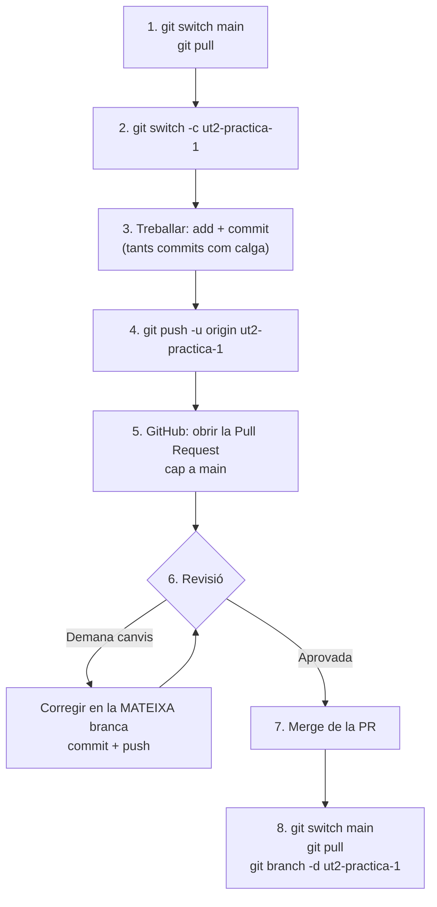

# 5. Pull Requests

## Què és una Pull Request

Una **Pull Request** (PR) és una **petició en GitHub per a ajuntar una branca amb una altra** (normalment amb `main`). En lloc de fer el `merge` directament, demanes: *«he fet estos canvis en esta branca; revisa'ls i, si estan bé, ajunta'ls»*.

En una PR es pot:

- veure **tots els canvis** que porta la branca, fitxer a fitxer;
- **comentar** línies concretes;
- **demanar canvis** o **aprovar**;
- fer el **merge** amb un botó.

Per això els professors les usen per a corregir les entregues: cada bloc de feina és una PR que poden revisar i comentar.

## El flux de treball complet



### Pas a pas

**1. Partir de `main` actualitzat**

```bash
git switch main
git pull
```

**2. Crear una branca per al bloc de feina**

```bash
git switch -c ut2-practica-1-presupuesto
```

**3. Treballar i fer commits**

```bash
git add .
git commit -m "Afig el formulari de pressupost"
# ... més feina ...
git commit -am "Valida que els camps no estiguen buits"
```

**4. Pujar la branca**

```bash
git push -u origin ut2-practica-1-presupuesto
```

GitHub et mostrarà en el terminal un enllaç per a crear la PR directament:

```console
remote: Create a pull request for 'ut2-practica-1-presupuesto' on GitHub by visiting:
remote:      https://github.com/usuari/repo/pull/new/ut2-practica-1-presupuesto
```

**5. Obrir la Pull Request en GitHub**

1. Entra al repositori. Veuràs un avís groc: ***Compare & pull request*** → fes-hi clic. (O pestanya **Pull requests → New pull request**.)
2. Comprova que va **de la teua branca** (*compare*) **cap a `main`** (*base*).
3. Posa un **títol** clar: *«UT2 · Pràctica 1 · Formulari de pressupost»*.
4. En la **descripció**, explica què has fet, com provar-ho i si has usat IA (si ho demanen). Si el repositori té una plantilla de PR, ja t'apareixerà el text a omplir.
5. Si cal, en **Reviewers** tria el professor.
6. **Create pull request**.

**6. Revisió**

El professor (o un company) mira els canvis en la pestanya ***Files changed*** i pot:

- **Comment**: comentaris generals.
- **Request changes**: demana que corregisques coses.
- **Approve**: tot correcte.

Si et demanen canvis, **no cal fer una PR nova**: corregix en **la mateixa branca**, fes commit i push, i la PR s'actualitza sola.

```bash
# continues en la branca ut2-practica-1-presupuesto
git commit -am "Corregix la validació del correu"
git push
```

**7. Merge**

Quan està aprovada, botó **Merge pull request** → **Confirm merge**. Ara els canvis estan en `main` de GitHub. GitHub oferix el botó **Delete branch** per a esborrar la branca remota.

!!! note "Qui fa el merge?"
    Depén del que diga el professor: de vegades el fa ell en aprovar, de vegades l'alumne després de l'aprovació. Pregunta-ho si no ho tens clar.

**8. Actualitzar el teu equip**

El merge s'ha fet en GitHub, no en el teu ordinador. Cal portar-lo:

```bash
git switch main
git pull                                   # ara tens els canvis en el teu main
git branch -d ut2-practica-1-presupuesto   # esborrar la branca local
```

I ja pots començar el següent bloc des del pas 1.

## Bones pràctiques en PR

- **Una PR per bloc de feina**: no barreges la pràctica 1 i la 2 en la mateixa.
- **Commits xicotets i amb missatges clars**: el professor veu la llista de commits de la PR.
- **Revisa tu mateix** la pestanya *Files changed* abans d'enviar-la: veuràs si has pujat fitxers que no tocaven (`.env`, fitxers temporals...).
- **No faces merge de la teua PR** si el flux diu que l'ha d'aprovar algú abans.
- Respon els comentaris amb el commit que ho corregix.

## Forks: contribuir a repositoris que no són teus

Si vols proposar un canvi en un repositori on **no** tens permís d'escriure (per exemple, uns apunts públics d'algú):

1. **Fork** (botó dalt a la dreta): crea una còpia del repositori en el teu compte.
2. Clona **el teu fork**, crea una branca, fes els canvis, push.
3. Obri una PR **del teu fork cap al repositori original**.

## Errors típics

| Problema | Per què | Solució |
| -------- | ------- | ------- |
| La PR inclou commits d'una altra pràctica | Vas crear la branca des d'una altra branca, no des de `main` | Crea les branques **sempre** des de `main` actualitzat |
| *This branch has conflicts that must be resolved* | `main` ha canviat i toca les mateixes línies | En la teua branca: `git pull origin main`, resol el conflicte, commit, push |
| He tancat la PR sense voler | — | Botó **Reopen pull request** |
| Després del merge, el meu `main` local no té els canvis | El merge es va fer en GitHub | `git switch main && git pull` |
| He fet la feina directament en `main` | No has creat la branca | Mira els [casos pràctics](casos.md#he-treballat-en-main-i-havia-de-ser-en-una-branca) |

!!! success "Per a l'examen"
    1. `git switch main && git pull`
    2. `git switch -c nom-del-bloc`
    3. `git add` + `git commit` (els que calga)
    4. `git push -u origin nom-del-bloc`
    5. GitHub → **Compare & pull request** (de la branca **cap a `main`**)
    6. Revisió: si demanen canvis → commit + push **en la mateixa branca**
    7. **Merge pull request**
    8. `git switch main && git pull && git branch -d nom-del-bloc`
