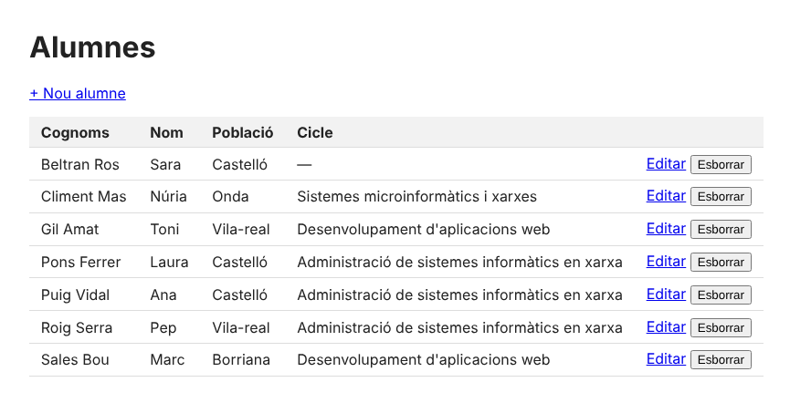
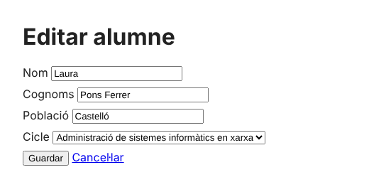

# 6. Una aplicació CRUD

**CRUD** = *Create, Read, Update, Delete*: crear, llegir, modificar i esborrar. És el que fan la majoria d'aplicacions de gestió. Ací, una aplicació per a gestionar els **alumnes** de la [base de dades `institut`](index.md#la-base-de-dades-dexemple), amb tot el que s'ha vist: formularis, validació, `htmlspecialchars` i PDO amb consultes preparades.

[:material-download: Descarrega el codi complet (crud-alumnes.zip)](../assets/fitxers/php/crud-alumnes.zip)



## L'estructura

```text
crud-alumnes/
├── config.php      dades de connexió
├── db.php          funció per a connectar i funció per a escapar
├── index.php       LLISTAR (Read) + botó d'esborrar
├── form.php        CREAR (Create) i EDITAR (Update): el mateix formulari
├── esborra.php     ESBORRAR (Delete)
└── estil.css
```

| L'usuari... | Petició | Què passa |
| ----------- | ------- | --------- |
| obri l'aplicació | `GET index.php` | llista d'alumnes |
| prem «+ Nou alumne» | `GET form.php` | formulari buit |
| guarda | `POST form.php` | `INSERT` → redirecció a `index.php` |
| prem «Editar» | `GET form.php?id=3` | formulari amb les dades de l'alumne 3 |
| guarda | `POST form.php?id=3` | `UPDATE` → redirecció a `index.php` |
| prem «Esborrar» | `POST esborra.php` (amb `id=3`) | `DELETE` → redirecció a `index.php` |

## `config.php` i `db.php`

```php title="config.php"
<?php
// Dades de connexió. En producció, fora del DocumentRoot o en variables d'entorn.
return [
    "dsn"   => "pgsql:host=127.0.0.1;port=5433;dbname=institut",
    "user"  => "app",
    "clau"  => "canvia-la",
];
```

```php title="db.php"
<?php
function bd(): PDO
{
    static $pdo = null;                       // una sola connexió per petició
    if ($pdo === null) {
        $c = require __DIR__ . "/config.php";
        $pdo = new PDO($c["dsn"], $c["user"], $c["clau"], [
            PDO::ATTR_ERRMODE            => PDO::ERRMODE_EXCEPTION,
            PDO::ATTR_DEFAULT_FETCH_MODE => PDO::FETCH_ASSOC,
        ]);
    }
    return $pdo;
}

function e(?string $text): string             // escapar per a HTML
{
    return htmlspecialchars($text ?? "", ENT_QUOTES, "UTF-8");
}
```

- `static $pdo`: la variable es manté entre crides; així, encara que es cride `bd()` moltes vegades, només es connecta **una**.
- `e()`: per a escriure `<?= e($x) ?>` en lloc de `<?= htmlspecialchars($x, ENT_QUOTES, "UTF-8") ?>` cada vegada.

## Llistar: `index.php`

```php title="index.php"
<?php
require __DIR__ . "/db.php";

$alumnes = bd()->query(
    "SELECT a.id, a.nom, a.cognoms, a.poblacio, c.nom AS cicle
     FROM alumnes a LEFT JOIN cicles c ON c.codi = a.cicle
     ORDER BY a.cognoms"
)->fetchAll();
?>
<!DOCTYPE html>
<html lang="ca">
<head><meta charset="UTF-8"><link rel="stylesheet" href="estil.css"><title>Alumnes</title></head>
<body>
    <h1>Alumnes</h1>
    <p><a href="form.php">+ Nou alumne</a></p>
    <table>
        <tr><th>Cognoms</th><th>Nom</th><th>Població</th><th>Cicle</th><th></th></tr>
        <?php foreach ($alumnes as $a): ?>
        <tr>
            <td><?= e($a["cognoms"]) ?></td>
            <td><?= e($a["nom"]) ?></td>
            <td><?= e($a["poblacio"]) ?></td>
            <td><?= e($a["cicle"] ?? "—") ?></td>
            <td>
                <a href="form.php?id=<?= $a["id"] ?>">Editar</a>
                <form method="post" action="esborra.php" style="display:inline"
                      onsubmit="return confirm('Segur?')">
                    <input type="hidden" name="id" value="<?= $a["id"] ?>">
                    <button>Esborrar</button>
                </form>
            </td>
        </tr>
        <?php endforeach; ?>
    </table>
</body>
</html>
```

- **`LEFT JOIN`** perquè isquen també els alumnes **sense** cicle (Sara).
- `$a["cicle"] ?? "—"`: si és `NULL`, una ratlla.
- Esborrar és un **formulari POST**, no un enllaç: un enllaç (GET) el podria «visitar» un cercador o el navegador en precarregar la pàgina, i esborraria dades.

## Crear i editar: `form.php`

```php title="form.php"
<?php
require __DIR__ . "/db.php";

$id = filter_input(INPUT_GET, "id", FILTER_VALIDATE_INT) ?: null;   // si hi ha id: editar
$alumne = ["nom" => "", "cognoms" => "", "poblacio" => "", "cicle" => ""];
$errors = [];

if ($id) {
    $stmt = bd()->prepare("SELECT nom, cognoms, poblacio, cicle FROM alumnes WHERE id = ?");
    $stmt->execute([$id]);
    $alumne = $stmt->fetch() ?: exit("No existix l'alumne $id");
}

if ($_SERVER["REQUEST_METHOD"] === "POST") {
    $alumne = [
        "nom"      => trim($_POST["nom"] ?? ""),
        "cognoms"  => trim($_POST["cognoms"] ?? ""),
        "poblacio" => trim($_POST["poblacio"] ?? ""),
        "cicle"    => $_POST["cicle"] ?: null,
    ];
    if ($alumne["nom"] === "")     $errors[] = "Falta el nom.";
    if ($alumne["cognoms"] === "") $errors[] = "Falten els cognoms.";

    if (!$errors) {
        if ($id) {
            $stmt = bd()->prepare("UPDATE alumnes SET nom = :nom, cognoms = :cognoms,
                                   poblacio = :poblacio, cicle = :cicle WHERE id = :id");
            $stmt->execute($alumne + ["id" => $id]);
        } else {
            $stmt = bd()->prepare("INSERT INTO alumnes (nom, cognoms, poblacio, cicle)
                                   VALUES (:nom, :cognoms, :poblacio, :cicle)");
            $stmt->execute($alumne);
        }
        header("Location: index.php");          // patró PRG: Post → Redirect → Get
        exit;
    }
}

$cicles = bd()->query("SELECT codi, nom FROM cicles ORDER BY nom")->fetchAll();
?>
<!DOCTYPE html>
<html lang="ca">
<head><meta charset="UTF-8"><link rel="stylesheet" href="estil.css"><title><?= $id ? "Editar" : "Nou" ?> alumne</title></head>
<body>
    <h1><?= $id ? "Editar" : "Nou" ?> alumne</h1>
    <?php foreach ($errors as $err): ?><p class="error"><?= e($err) ?></p><?php endforeach; ?>
    <form method="post">
        <label>Nom <input name="nom" value="<?= e($alumne["nom"]) ?>"></label>
        <label>Cognoms <input name="cognoms" value="<?= e($alumne["cognoms"]) ?>"></label>
        <label>Població <input name="poblacio" value="<?= e($alumne["poblacio"]) ?>"></label>
        <label>Cicle
            <select name="cicle">
                <option value="">—</option>
                <?php foreach ($cicles as $c): ?>
                    <option value="<?= e($c["codi"]) ?>" <?= $c["codi"] === $alumne["cicle"] ? "selected" : "" ?>>
                        <?= e($c["nom"]) ?>
                    </option>
                <?php endforeach; ?>
            </select>
        </label>
        <button>Guardar</button> <a href="index.php">Cancel·lar</a>
    </form>
</body>
</html>
```



**Com sap si ha de crear o editar?** Per l'`id` de la URL:

| URL | `$id` | Fa |
| --- | ----- | -- |
| `form.php` | `null` | formulari buit → `INSERT` |
| `form.php?id=3` | `3` | carrega les dades de l'alumne 3 → `UPDATE` |
| `form.php?id=abc` | `null` (`filter_input` torna `false` → `?: null`) | com si fora nou |

- `$alumne + ["id" => $id]`: ajunta els dos arrays per a passar tots els paràmetres a l'`UPDATE`.
- `$_POST["cicle"] ?: null`: si s'ha triat «—» (text buit), es guarda `NULL`.
- `selected`: per a deixar marcat en el `<select>` el cicle que ja tenia.
- **PRG**: després de guardar, redirecció a la llista.

## Esborrar: `esborra.php`

```php title="esborra.php"
<?php
require __DIR__ . "/db.php";

$id = filter_input(INPUT_POST, "id", FILTER_VALIDATE_INT);
if ($_SERVER["REQUEST_METHOD"] === "POST" && $id) {
    $stmt = bd()->prepare("DELETE FROM alumnes WHERE id = ?");
    $stmt->execute([$id]);
}
header("Location: index.php");
exit;
```

Les matrícules de l'alumne s'esborren soles perquè la clau forana té `ON DELETE CASCADE`.

## Provar-la

```bash
cd crud-alumnes
nano config.php                       # les teues dades de connexió
php -S localhost:8000                 # i obrir http://localhost:8000
```

**Provat amb `curl`** (resultats reals):

```console
$ curl -s -o /dev/null -w "%{http_code}\n" --data-urlencode "nom=Joan" --data-urlencode "cognoms=Albà Ros" \
       -d "poblacio=Onda&cicle=ASIR" http://localhost:8000/form.php
302                                           ← creat, i redirigix a la llista
$ curl -s -d "nom=&cognoms=&poblacio=&cicle=" http://localhost:8000/form.php | grep error
    <p class="error">Falta el nom.</p><p class="error">Falten els cognoms.</p>
$ curl -s -o /dev/null -w "%{http_code}\n" -d "nom=Laura&cognoms=Pons Ferrer&poblacio=Benicàssim&cicle=ASIR" \
       "http://localhost:8000/form.php?id=3"
302                                           ← modificat
$ curl -s -o /dev/null -w "%{http_code}\n" -d "id=7" http://localhost:8000/esborra.php
302                                           ← esborrat
```

```console
$ psql -d institut -c "SELECT id, nom, poblacio, cicle FROM alumnes ORDER BY id"
 id |  nom  |  poblacio  | cicle
----+-------+------------+-------
  1 | Ana   | Castelló   | ASIR
  2 | Pep   | Vila-real  | ASIR
  3 | Laura | Benicàssim | ASIR
  4 | Marc  | Borriana   | DAW
  5 | Núria | Onda       | SMX
  6 | Toni  | Vila-real  | DAW
  8 | Joan  | Onda       | ASIR
(7 rows)
```

## Què li faltaria per a ser una aplicació real

- **Autenticació**: que només hi entre el personal ([sessions](04-sessions.md)), en cada pàgina.
- **Protecció CSRF**: un *token* aleatori en cada formulari, guardat en la sessió i comprovat en rebre'l, perquè una altra web no puga enviar formularis en nom d'un usuari que ha entrat.
- **Paginació** (`LIMIT` i `OFFSET`) si hi ha molts alumnes, i un cercador.
- Gestionar l'error de clau forana (un cicle que no existix) amb un missatge clar.
- Un **framework** (Laravel, Symfony) fa tot açò (rutes, plantilles, validació, CSRF, ORM) de sèrie.

## Errors típics

| Problema | Per què | Solució |
| -------- | ------- | ------- |
| `Cannot modify header information` en guardar | Alguna eixida abans del `header()` (un espai abans de `<?php` en `db.php` o `config.php`) | Res abans de `<?php`, i sense `?>` final en els fitxers només PHP |
| L'edició crea un alumne nou | El formulari no conserva l'`id` (el `action` buit manté la URL amb `?id=`; si poses `action="form.php"`, el perds) | `action=""` o un camp ocult amb l'`id` |
| El `<select>` no marca el cicle | Comparació amb tipus diferents | `===` amb el mateix tipus (els dos textos) |
| `SQLSTATE[23503]: Foreign key violation` | Un `cicle` que no existix en la taula `cicles` | Valida'l amb la llista de cicles |
| Els accents ixen malament | Falta `<meta charset="UTF-8">` o la base de dades no és UTF-8 | UTF-8 en tot |

!!! success "Per a l'examen"
    - **C**reate (`INSERT`) · **R**ead (`SELECT`) · **U**pdate (`UPDATE`) · **D**elete (`DELETE`)
    - Un formulari per a crear i editar: si hi ha **`id`**, carrega i fa `UPDATE`; si no, `INSERT`
    - Esborrar amb **POST** (mai amb un enllaç GET) · **PRG** després de guardar
    - Tot amb **consultes preparades** i tot el que es mostra amb **`htmlspecialchars`**
