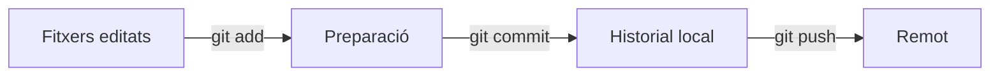

# UT0 · Git i GitHub per a guardar i entendre els canvis

## Què guarda cada eina?

Git és el programa que conserva l'historial al teu equip. GitHub allotja una còpia remota i ofereix col·laboració. Pots fer commits sense connexió; per a enviar-los al remot necessites xarxa i permisos.



`git add` selecciona el contingut que entrarà en el pròxim commit. Si després tornes a editar el fitxer, la nova edició encara no està preparada. `git pull` obté i integra canvis remots; pot produir conflictes que has de revisar.

## Cas resolt: corregir un inventari de cables

**Objectiu nou:** registrar que l'estoc real és de 8 cables. Crea una carpeta de laboratori que no estiga dins d'un altre repositori. Aquest exemple és local i no crea ni envia res a GitHub.

```bash
mkdir inventari-lab
cd inventari-lab
git init
git config user.name "Estudiant de proves"
git config user.email "estudiant@example.com"
printf 'Cables: 7\n' > inventari.txt
git add inventari.txt
git commit -m "Registra inventari inicial"
printf 'Cables: 8\n' > inventari.txt
git diff
git add inventari.txt
git diff --cached
git commit -m "Corregeix el recompte de cables"
git status --short
git log --oneline
```

### Què comproves en cada pas?

1. `init` crea l'historial buit. `clone URL` seria l'alternativa per a un projecte existent; no cal fer `init` dins d'un clon.
2. La configuració sense `--global` s'aplica només al laboratori. Nom i correu identifiquen l'autor; no autentiquen l'accés a GitHub.
3. El primer commit guarda 7. Després, `diff` mostra una línia eliminada amb 7 i una afegida amb 8.
4. `diff --cached` revisa exactament el canvi preparat.
5. Després del segon commit, `status --short` no mostra canvis pendents. `log` mostra dos commits, amb identificadors variables.

**Per als treballs:** revisa `status` i el diff abans del commit. Un missatge com «Valida camps buits del formulari» explica millor el canvi que «coses».

## Connexió amb GitHub i SSH

En un repositori amb remot i branca configurats, `git push` envia commits i `git pull` integra els del remot. `git remote -v` permet comprovar a quin repositori apuntes. Si la primera pujada ho requereix, `git push -u origin NOM_BRANCA` vincula la branca local amb la remota; substitueix el nom pel real.

Una clau SSH té una part pública i una privada. GitHub rep la **pública**, acabada en `.pub`. La privada es queda al teu equip. `ssh -T git@github.com` comprova l'autenticació SSH; un missatge d'autenticació correcta pot anar acompanyat d'un codi d'eixida diferent de zero perquè GitHub no ofereix una shell interactiva.

## Errors típics

| Símptoma | Causa probable |
| --- | --- |
| `nothing to commit` | No hi ha canvis preparats o no hi ha canvis nous. |
| Veig el commit local però no en GitHub | Falta `push`, ha fallat o mires una altra branca. |
| `Permission denied (publickey)` | Clau, agent SSH o compte sense accés. |
| Rebuig perquè el remot ha avançat | Revisa i integra els canvis remots abans d'enviar. |

!!! success "Per a repassar"
    Editar, preparar, guardar localment i enviar són quatre passos diferents. Explica en quin estat està el teu canvi abans de repetir ordres.

---

Font del temari: [apunts originals d’ASO](https://angelabserrano.github.io/aso/git/introduccion/). Explicació i casos didàctics propis. Consulta: 26/10/2026.
