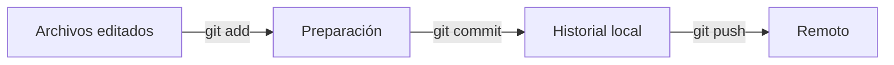

# Git y GitHub

Tema independiente y transversal a IAW, ASO y Python. Cubre la introducción de UT0 de ASO: guardar, revisar y compartir cambios.

## ¿Qué guarda cada herramienta?

Git es el programa que conserva el historial en tu equipo. GitHub aloja una copia remota y ofrece colaboración. Puedes hacer commits sin conexión; para enviarlos al remoto necesitas red y permisos.



`git add` selecciona el contenido que entrará en el próximo commit. Si después vuelves a editar el archivo, la nueva edición todavía no está preparada. `git pull` obtiene e integra cambios remotos; puede producir conflictos que debes revisar.

## Qué problema resuelve Git cuando estudias o programas

Guardar un archivo conserva su contenido actual, pero no explica qué cambió desde ayer ni por qué. Copiar carpetas con nombres como `final`, `final2` o `definitivo` conserva algunas versiones, pero hace difícil comparar y saber cuál contiene cada cambio. Git registra estados del proyecto y sus relaciones para poder revisar esa evolución.

GitHub permite alojar una copia remota del repositorio. No sustituye al historial local ni convierte automáticamente en commit todo lo que escribas en tu editor. Primero decides qué guardar en Git y después qué enviar al remoto. Esta separación explica por qué puedes tener cambios en el ordenador que todavía no aparecen en GitHub.

## Las tres zonas con un ejemplo de una sola línea

Imagina un archivo `inventario.txt` que dice `Cables: 7` y ya pertenece a un commit. Lo editas para que diga `Cables: 8`. Ahora hay una diferencia entre tu carpeta de trabajo y el último estado guardado.

`git add inventario.txt` prepara el contenido que quieres incluir en el próximo commit. No crea aún el commit. `git commit` registra lo preparado. `git push` intenta enviar los commits que faltan al remoto. Son pasos distintos que puedes observar por separado.

Si preparas el archivo cuando dice 8 y después lo editas otra vez para que diga 9, no se actualiza mágicamente lo preparado. Puedes tener una versión preparada con 8 y una edición posterior con 9. `git diff --cached` permite revisar lo primero y `git diff` lo segundo.

Esto es útil cuando una carpeta contiene trabajo a medias: no necesitas guardar todo junto por el simple hecho de que esté modificado. El área de preparación permite seleccionar un cambio coherente, revisarlo y describirlo con un mensaje.

## Leer `status` antes de decidir el siguiente paso

Un archivo nuevo aparece como no seguido, normalmente con `??` en la vista corta. Uno registrado y modificado aparece como modificación. La columna de preparación y la de la carpeta de trabajo expresan estados distintos; un mismo archivo puede tener cambios en ambas.

No utilices `git add .` como respuesta automática a cualquier mensaje. Primero mira qué entraría, especialmente si hay archivos generados, configuraciones locales o datos que no quieres publicar. Preparar archivos concretos facilita aprender qué está ocurriendo.

Después de un commit correcto, el árbol puede quedar limpio. Eso solo informa de los cambios locales pendientes: no demuestra por sí mismo que ya hayas enviado el commit ni que estés mirando en GitHub la misma rama.

## Un commit registra una decisión que debes poder explicar

El mensaje debería resumir qué aporta el cambio. «Corrige el recuento de cables» relaciona el commit con una modificación concreta. «Cosas» no ayuda a encontrarlo después. No necesitas escribir un texto largo para una edición pequeña, pero sí identificar su propósito.

Un commit tampoco es una prueba automática de que funcione. Puedes registrar un programa con un error. Antes de guardarlo, ejecuta la comprobación que corresponda y revisa el diff para saber qué estás incluyendo.

El identificador del commit permite referirse a él con precisión. `HEAD` indica el punto actual del trabajo, normalmente a través de la rama activa. `origin/main` representa la información local que tienes de esa rama remota después de actualizarla; no es una lectura continua de Internet.

## Trabajar con una rama sin imaginar otra carpeta

Una rama permite avanzar desde un punto del historial. Al cambiar de rama, Git ajusta la versión de los archivos registrados en la carpeta de trabajo. No crea necesariamente una carpeta nueva que tengas que localizar en el explorador.

Si hay modificaciones sin guardar, cambiar de rama puede conservarlas cuando sea compatible o impedir el cambio cuando se perderían. Por eso debes revisar `status` antes de moverte. Si quieres empezar un trabajo nuevo, entiende primero desde qué rama y commit lo estás iniciando.

Fusionar reúne líneas de trabajo. Cuando Git no puede decidir cómo combinar un contenido, muestra un conflicto para que revises el resultado correcto. Un conflicto no significa que se haya borrado todo: significa que falta una decisión que Git no puede tomar por ti.

## Qué debes dominar primero y qué puedes consultar

Para empezar, practica el ciclo editar → revisar → preparar → commit y distingue cuándo se envía al remoto. Después aprende a crear una rama, integrarla y reconocer un conflicto. Las herramientas para deshacer se estudian a partir de una pregunta concreta: qué cambio quieres retirar y dónde está guardado.

No memorices una orden de borrado para cualquier problema. Eliminar una edición sin commit, corregir un mensaje y revertir un commit compartido son tareas diferentes. La tabla de recuperación de este tema sirve como consulta después de entender esa diferencia.

## Problema explicado paso a paso: corregir un inventario de cables

Registrar que el stock real es de 8 cables. Crea una carpeta de laboratorio que no esté dentro de otro repositorio. Este ejemplo es local y no crea ni envía nada a GitHub.

```bash
mkdir inventario-lab
cd inventario-lab
git init
git config user.name "Estudiante de pruebas"
git config user.email "estudiante@example.com"
printf 'Cables: 7\n' > inventario.txt
git add inventario.txt
git commit -m "Registra el inventario inicial"
printf 'Cables: 8\n' > inventario.txt
git diff
git add inventario.txt
git diff --cached
git commit -m "Corrige el recuento de cables"
git status --short
git log --oneline
```

### ¿Qué compruebas en cada paso?

1. `init` crea el historial vacío. `clone URL` sería la alternativa para un proyecto existente; no debes hacer `init` dentro de un clon.
2. La configuración sin `--global` se aplica solo al laboratorio. Nombre y correo identifican al autor; no autentican el acceso a GitHub.
3. El primer commit guarda 7. Después, `diff` muestra una línea eliminada con 7 y otra añadida con 8.
4. `diff --cached` permite revisar exactamente el cambio preparado.
5. Después del segundo commit, `status --short` no muestra cambios pendientes. `log` muestra dos commits, con identificadores variables.

**Para los trabajos:** revisa `status` y el diff antes del commit. Un mensaje como «Valida campos vacíos del formulario» explica mejor el cambio que «cosas».

## Conexión con GitHub y SSH

En un repositorio con remoto y rama configurados, `git push` envía commits y `git pull` integra los del remoto. `git remote -v` permite comprobar a qué repositorio apuntas. Si la primera subida lo requiere, `git push -u origin NOMBRE_RAMA` vincula la rama local con la remota; sustituye el nombre por el real.

Una clave SSH tiene una parte pública y otra privada. GitHub recibe la **pública**, terminada en `.pub`. La privada se queda en tu equipo. `ssh -T git@github.com` comprueba la autenticación SSH; un mensaje de autenticación correcta puede ir acompañado de un código de salida distinto de cero porque GitHub no ofrece una shell interactiva.

## Errores típicos

| Síntoma | Causa probable |
| --- | --- |
| `nothing to commit` | No hay cambios preparados o no hay cambios nuevos. |
| Veo el commit local, pero no en GitHub | Falta `push`, ha fallado o miras otra rama. |
| `Permission denied (publickey)` | Clave, agente SSH o cuenta sin acceso. |
| Rechazo porque el remoto ha avanzado | Revisa e integra los cambios remotos antes de enviar. |

## Preparar un trabajo real: `.gitignore` y revisión

Un archivo `.gitignore` indica patrones de archivos que no quieres empezar a registrar, como `.env`, `.venv/` o `__pycache__/`. No borra archivos ni retira automáticamente del historial lo que ya estaba registrado.

Antes de guardar un cambio, distingue `git diff` (ediciones sin preparar), `git diff --cached` (contenido preparado) y `git log --oneline` (commits existentes). `git commit -am` solo incluye cambios de archivos que Git ya conoce; no añade archivos nuevos.

Si un archivo con credenciales ya se publicó, añadirlo al `.gitignore` no protege el secreto anterior. Revoca o cambia la credencial y revisa después cómo retirar los datos del historial según el proyecto.

## Ramas: una línea de trabajo para cada cambio

Una rama es una referencia que permite continuar una línea de trabajo sin mezclarla inmediatamente con otra. No es una copia manual de la carpeta. La rama inicial puede llamarse `main`, `master` u otro nombre: compruébalo con `git branch --show-current`.

### Problema explicado paso a paso: añadir una ubicación al inventario

Continúa en el laboratorio local del inventario y con el árbol de trabajo limpio:

```bash
git switch -c ubicacion
printf 'Ubicación: armario azul\n' > ubicacion.txt
git add ubicacion.txt
git commit -m "Documenta la ubicación del material"
git switch -
git merge ubicacion
git branch -d ubicacion
```

1. `switch -c` crea y activa la rama `ubicacion`.
2. El commit se guarda en esa rama; cambiar de rama cambia la versión visible de los archivos registrados.
3. `switch -` vuelve a la rama anterior, sea cual sea su nombre.
4. `merge` incorpora el cambio a esa rama. En este caso sencillo puede avanzar directamente su referencia, sin crear un commit de fusión.
5. `branch -d` elimina la referencia local ya integrada; el contenido fusionado sigue en la rama principal.

**Resultado esperado:** `ubicacion.txt` está en la rama de partida y contiene `Ubicación: armario azul`. No se ha enviado nada al remoto.

## Conflictos: decidir el contenido final

Si dos líneas de trabajo modifican de manera incompatible la misma zona, Git puede detener la integración. Un archivo en conflicto muestra marcas como:

```text
    <<<<<<< HEAD
    Cables: 8
    =======
    Cables: 9
    >>>>>>> recuento
```

No elijas un lado sin comprobar los hechos. Revisa cuál es el inventario correcto, escribe el resultado final y elimina las marcas. Después usa `git add inventario.txt` y completa el commit de fusión. `git status` explica qué falta. Si has decidido cancelar una fusión en curso, `git merge --abort` intenta volver al estado previo; revisa antes los cambios que tenías.

Un rechazo de `push` no siempre es un conflicto de contenido: puede indicar simplemente que el remoto tiene commits que faltan en tu equipo. `git fetch` actualiza las referencias remotas sin integrar esos cambios en tu rama; permite inspeccionarlos antes de decidir la integración. Cuando ambos lados han avanzado, `git pull --no-rebase` solicita una integración mediante merge; úsalo si es la estrategia elegida para el proyecto.

## Pull Request: proponer y revisar

Una PR es una petición de revisión e integración en GitHub, no un comando local de Git. Un flujo habitual es:

1. Partir de la rama base actualizada y crear una rama para el cambio.
2. Editar, probar y hacer commits coherentes.
3. Enviar la rama con `git push -u origin NOMBRE_RAMA`.
4. Abrir la PR desde la rama de trabajo (*compare*) hacia la rama de destino (*base*).
5. Explicar qué cambia, cómo se comprueba y qué límites tiene.
6. Corregir en la misma rama: los nuevos commits enviados actualizan la PR.
7. Integrarla cuando corresponda según la revisión y actualizar después la rama local de destino.

Una PR abierta no significa que el cambio ya esté integrado. Un *fork* es una copia alojada bajo otra cuenta, útil para proponer cambios donde no tienes permisos de escritura. `clone` crea la copia de trabajo local; fork y clone no son lo mismo.

## Deshacer: elige según dónde esté el cambio

| Situación | Herramienta | Efecto que debes entender |
| --- | --- | --- |
| Preparaste un archivo por error | `git restore --staged archivo` | Lo saca de preparación sin borrar su edición |
| Quieres descartar ediciones sin commit | `git restore archivo` | Sustituye esas ediciones; revisa primero el diff |
| Último commit local con mensaje incorrecto | `git commit --amend` | Crea un commit sustituto; cambia su identificador |
| Commit ya compartido que hay que deshacer | `git revert IDENTIFICADOR` | Crea otro commit con el cambio inverso |
| Apartar trabajo sin terminar | `git stash push -u -m "trabajo pendiente"` | Guarda temporalmente cambios, incluidos archivos nuevos |
| Recuperar el trabajo apartado | `git stash apply` | Reaplica sin borrar todavía la entrada del stash |
| Investigar movimientos de referencias | `git reflog` | Muestra un registro local útil para recuperación |

`git reset --soft HEAD~1` mueve la referencia de la rama un commit atrás y deja sus cambios preparados; no es la herramienta predeterminada para deshacer commits compartidos. `reset --hard` también descarta cambios de trabajo: no lo ejecutes por ensayo y error.

### Problema explicado paso a paso: un archivo se preparó antes de terminarlo

Si `ubicacion.txt` está editado y preparado, pero no debe entrar aún en el próximo commit, revisa `git diff --cached`, ejecuta `git restore --staged ubicacion.txt` y consulta `git status`. El archivo conserva su contenido editado, pero deja de estar preparado. No has perdido la edición ni modificado un commit.

## Errores frecuentes al entregar trabajos

| Mensaje o situación | Qué revisas |
| --- | --- |
| `remote origin already exists` | `git remote -v`; quizá necesitas `set-url`, no añadir otro remoto |
| `no upstream branch` | Primera subida: `git push -u origin NOMBRE_RAMA` |
| `not a git repository` | Carpeta actual y existencia del repositorio original |
| `HEAD detached` | Estás en un commit concreto; crea una rama si quieres conservar trabajo nuevo |
| La PR incluye otro trabajo | Rama de partida y commits incluidos antes de crearla |
| El merge de GitHub no aparece localmente | Actualiza la rama local correspondiente |

## Palabras clave de este tema

| Término | Significado en este tema |
| --- | --- |
| **Repositorio** | Proyecto cuyo historial registra Git, normalmente mediante el directorio `.git`. |
| **Commit** | Instantánea registrada de contenido con autor, mensaje y relación con commits anteriores. |
| **Rama** | Referencia a una línea de trabajo; su nombre principal no es obligatorio que sea `main`. |
| **Remoto** | Destino o fuente configurada para intercambiar datos Git, como `origin`. |
| **Push, fetch y pull** | Enviar commits, obtener información remota e integrar tras obtener, respectivamente. |
| **Merge y conflicto** | Integración de líneas de trabajo y situación que exige decidir cómo resolver cambios incompatibles. |
| **Pull Request** | Propuesta de revisión e integración gestionada en GitHub. |
| **Fork** | Repositorio copiado bajo otra cuenta para desarrollar o proponer cambios. |

!!! success "Para repasar"
    Editar, preparar, guardar localmente y enviar son cuatro pasos diferentes. Explica en qué estado está tu cambio antes de repetir comandos.

---

Fuente del temario: [apuntes originales de ASO](https://angelabserrano.github.io/aso/git/introduccion/). Explicación y casos didácticos propios. Consulta: 26/10/2026.
