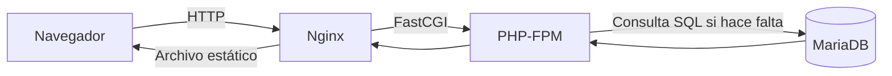

# UT1 · 1. Cómo funciona una aplicación web

## Palabras clave de este tema

| Término | Significado en este tema |
| --- | --- |
| **Servidor web** | Programa que recibe peticiones HTTP y sirve recursos; en este stack es Nginx. |
| **Backend / PHP** | Parte que procesa la petición en el servidor; PHP es el lenguaje usado aquí. |
| **Lenguaje de marcas** | Describe la estructura de un documento mediante etiquetas, como HTML o XML. |
| **Etiqueta y atributo HTML** | La etiqueta define un elemento; el atributo añade información, como `class` o `href`. |
| **Selector CSS** | Parte de una regla que identifica los elementos a los que se aplica. |
| **Modelo de caja** | Contenido, espacio interior, borde y margen de un elemento. |
| **Diseño adaptable y media query** | Presentación que se adapta al espacio disponible; una media query aplica reglas bajo una condición. |
| **SGBD y SQL** | Gestor de bases de datos y lenguaje utilizado para definir o consultar datos relacionales. |
| **Tabla, fila y columna** | Conjunto de registros, cada registro y cada uno de sus campos. |
| **Clave primaria y foránea** | Identificador de una fila y referencia a una clave de otra tabla. |
| **CRUD** | Crear, leer, actualizar y eliminar: las operaciones básicas sobre datos. |
| **JOIN** | Operación SQL que combina filas de tablas según una relación o condición. |
| **Transacción** | Grupo de operaciones que se confirma o revierte como una unidad, según las garantías del gestor. |
| **Índice de base de datos** | Estructura que acelera determinadas consultas a cambio de espacio y trabajo adicional al modificar datos. |
| **Normalización** | Organización de tablas y relaciones para reducir redundancias y anomalías de actualización. |

## La idea que debes entender

Una aplicación web atiende peticiones de un cliente. El navegador solicita un recurso, el servidor prepara una respuesta y el navegador la representa. Una URL es una dirección de acceso, no una carpeta cuyo contenido ejecute el navegador dentro del servidor.

**Estático** significa que el servidor entrega un archivo ya preparado. **Dinámico** significa que un programa calcula la respuesta en ese momento. Una página estática también puede ejecutar JavaScript y pedir datos a una API: en ese caso intervienen ambas formas de trabajar.

## Las piezas, explicadas con un museo

Imagina una web para consultar piezas de un museo:

| Componente | Qué hace | Qué no le corresponde |
| --- | --- | --- |
| Navegador | Solicita la ficha y muestra HTML, CSS e imágenes | Ejecutar el PHP del servidor |
| Nginx | Recibe HTTP, entrega archivos y deriva las peticiones PHP | Guardar la colección en tablas |
| PHP-FPM | Ejecuta PHP y genera la ficha | Representar visualmente el resultado en pantalla |
| MariaDB | Conserva los datos de las piezas | Interpretar HTML |

PHP es el lenguaje y su intérprete; **PHP-FPM** es el servicio que gestiona procesos de PHP y recibe trabajo mediante FastCGI. Nginx habla HTTP con el navegador, pero delega en PHP-FPM mediante FastCGI. El puerto 9000 de PHP-FPM no es una web que puedas abrir en el navegador.



## Caso resuelto: una sala y su cartel

**Situación:** `/carteles/sala-azul.svg` es una imagen guardada; `/pieza.php?codigo=47` consulta una pieza; `/ayuda.php` genera HTML sin consultar datos.

1. El cartel pasa del navegador a Nginx y vuelve como archivo. PHP y MariaDB no intervienen.
2. La ficha pasa por Nginx, PHP-FPM y MariaDB. La consulta devuelve datos; PHP crea HTML; Nginx lo envía al cliente.
3. La ayuda pasa por Nginx y PHP-FPM. Ser dinámica **no obliga** a tener una base de datos.

**Resultado:** el navegador recibe una imagen o HTML, según el recurso. No recibe las instrucciones PHP ni la contraseña utilizada para conectar con la base de datos.

**Cómo aplicarlo a los trabajos:** antes de escribir comandos, dibuja las piezas y anota quién se comunica con quién. Si falla una consulta SQL, cambiar el CSS no resuelve el problema: debes seguir el recorrido hasta PHP y la base de datos.

## Del LAMP clásico a los entornos reproducibles

LAMP combina Linux, Apache, MySQL/MariaDB y PHP, instalados habitualmente en el sistema. Otras combinaciones usan Nginx, PostgreSQL o runtimes como Node.js, Gunicorn/Uvicorn y Tomcat. Son piezas con funciones distintas, no herramientas intercambiables en todos los casos.

Un entorno reproducible guarda la configuración, las versiones y los pasos de arranque. Git registra esos archivos; Docker ejecuta servicios aislados; Compose describe cómo trabajan juntos. Un contenedor comparte el núcleo del sistema donde se ejecuta: no equivale a una máquina virtual con un sistema operativo completo.

## Errores típicos

| Confusión | Explicación correcta |
| --- | --- |
| «Nginx ejecuta PHP» | En este stack, deriva el trabajo a PHP-FPM. |
| «Toda página dinámica consulta SQL» | Puede calcular una respuesta sin base de datos. |
| «La imagen Docker guarda los datos nuevos» | Los cambios durante la ejecución y la persistencia son cuestiones distintas. |

## Qué representa el navegador: HTML y CSS

HTML es un lenguaje de marcas: describe títulos, párrafos, enlaces y formularios mediante etiquetas. No es el lenguaje que consulta la base de datos. CSS decide su presentación mediante selectores y reglas. PHP puede generar HTML; el navegador recibe ese resultado y aplica el CSS.

```html
<article class="ficha">
  <h2>Vasija azul</h2>
  <p>Una pieza de la colección.</p>
</article>
```

```css
.ficha {
  max-width: 36rem;
  padding: 1rem;
  border: 1px solid #777;
  margin: 1rem auto;
}
```

**Resultado esperado:** una ficha centrada, con un borde y espacio interior. `.ficha` es el selector de clase y `class="ficha"` es el atributo que conecta el elemento con esa regla. El modelo de caja distingue contenido, `padding`, `border` y `margin`.

Un diseño adaptable ajusta su presentación al espacio disponible. Una *media query* como `@media (min-width: 48rem)` aplica reglas solo cuando se cumple esa condición. Esto cambia la presentación; no cambia quién ejecuta PHP ni dónde se guardan los datos.

## Persistencia: qué añade un SGBD

Un sistema gestor de bases de datos (SGBD), como MariaDB, administra datos persistentes. En una base relacional, una tabla contiene filas y columnas. SQL permite definir y consultar esos datos. Una clave primaria identifica una fila; una clave foránea relaciona esa fila con otra tabla.

Conectar componentes no equivale a implementar un CRUD: crear, leer, actualizar y eliminar son operaciones de la aplicación. En UT1 interesa entender dónde vive cada responsabilidad. Los JOIN, índices y transacciones se desarrollarán con el tema de acceso a bases de datos, sin presentar esa unidad como publicada antes de tiempo.

!!! success "Para repasar"
    Identifica cliente, servidor web, runtime y persistencia. Después explica con tus palabras el recorrido de una petición estática y de una dinámica.

---

Fuente del temario: [apuntes originales de UT1](https://victoria-nr.github.io/iaw-alumnos/UT1/apuntes/). Explicación y casos didácticos propios. Consulta: 26/10/2026.
