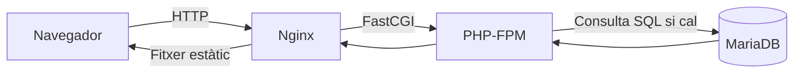

# UT1 · 1. Com funciona una aplicació web

## La idea que has d'entendre

Una aplicació web atén peticions d'un client. El navegador demana un recurs, el servidor prepara una resposta i el navegador la representa. Una URL és una adreça d'accés, no una carpeta que el navegador execute dins del servidor.

**Estàtic** significa que el servidor entrega un fitxer ja preparat. **Dinàmic** significa que algun programa calcula la resposta en aquell moment. Una pàgina estàtica també pot executar JavaScript i demanar dades a una API: en eixe cas intervenen les dues formes de treballar.

## Les peces, explicades amb un museu

Imaginem un web per a consultar peces d'un museu:

| Peça | Què fa | Què no li correspon |
| --- | --- | --- |
| Navegador | Demana la fitxa i mostra HTML, CSS i imatges | Executar el PHP del servidor |
| Nginx | Rep HTTP, entrega fitxers i deriva les peticions PHP | Guardar la col·lecció en taules |
| PHP-FPM | Executa PHP i genera la fitxa | Mostrar visualment el resultat a la pantalla |
| MariaDB | Conserva les dades de les peces | Interpretar HTML |

PHP és el llenguatge i el seu intèrpret; **PHP-FPM** és el servei que gestiona processos de PHP i rep treball mitjançant FastCGI. Nginx parla HTTP amb el navegador, però delega a PHP-FPM amb FastCGI. El port 9000 de PHP-FPM no és una web per a obrir-la al navegador.

## Cas resolt: una sala i el seu cartell

**Situació:** `/cartells/sala-blava.svg` és una imatge guardada; `/peca.php?codi=47` consulta una peça; `/ajuda.php` genera HTML sense consultar dades.

1. El cartell passa del navegador a Nginx i torna com a fitxer. PHP i MariaDB no intervenen.
2. La fitxa passa per Nginx, PHP-FPM i MariaDB. La consulta retorna dades; PHP crea HTML; Nginx l'envia al client.
3. L'ajuda passa per Nginx i PHP-FPM. Ser dinàmica **no obliga** a tindre una base de dades.

**Resultat:** el navegador rep una imatge o HTML, segons el recurs. No rep les instruccions PHP ni la contrasenya usada per a connectar a la base de dades.

**Com aplicar-ho als treballs:** abans d'escriure ordres, dibuixa les peces i anota qui parla amb qui. Si falla una consulta SQL, canviar el CSS no resol el problema: has de seguir el recorregut fins a PHP i la base de dades.

## Del LAMP clàssic als entorns reproduïbles

LAMP combina Linux, Apache, MySQL/MariaDB i PHP instal·lats habitualment al sistema. Altres combinacions usen Nginx, PostgreSQL o runtimes com Node.js, Gunicorn/Uvicorn i Tomcat. Són peces amb funcions diferents, no substituts tots de tots.

Un entorn reproduïble guarda la configuració, les versions i els passos d'arrancada. Git registra aquests fitxers; Docker executa serveis aïllats; Compose descriu com treballen junts. Un contenidor comparteix el nucli del sistema on s'executa: no equival a una màquina virtual amb un sistema operatiu complet.

## Errors típics

| Confusió | Explicació correcta |
| --- | --- |
| «Nginx executa PHP» | En aquest stack, deriva el treball a PHP-FPM. |
| «Tota pàgina dinàmica consulta SQL» | Pot calcular una resposta sense base de dades. |
| «La imatge Docker guarda les dades noves» | Els canvis d'execució i la persistència són qüestions diferents. |

!!! success "Per a repassar"
    Identifica client, servidor web, runtime i persistència. Després explica el viatge d'una petició estàtica i d'una dinàmica amb les teues paraules.

---

Font del temari: [apunts originals de UT1](https://victoria-nr.github.io/iaw-alumnos/UT1/apuntes/). Explicació i casos didàctics propis. Consulta: 26/10/2026.
